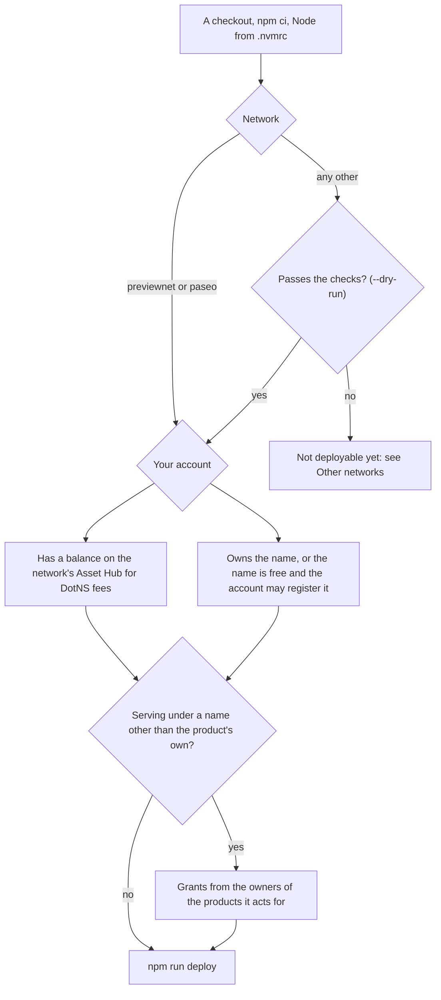

# Deployment

Parity publishes this code and runs no deployment of it for you. Each product deploys from a
checkout with one command, run by you with your own account. Nothing in this repository's CI
deploys: [`ci.yml`](.github/workflows/ci.yml) lints, type-checks, tests and builds, with no secrets.

## One command

```bash
npm ci
DOMAIN=my-game.paseo DOTNS_MNEMONIC="your twelve word phrase …" npm run deploy -- jollity paseo
DOMAIN=my-card.paseo DOTNS_MNEMONIC="your twelve word phrase …" npm run deploy -- humanity paseo
```

`DOMAIN` is the DotNS name you publish to, TLD included. `DOTNS_MNEMONIC` (or `MNEMONIC`) is the 12-
or 24-word phrase of the account that registers or owns it. Never commit it. The script refuses to
run without one, because `bulletin-deploy` would otherwise sign with a well-known development
account that anyone can use to repoint your name.

Add `--dry-run` to see what would be built and published, and for a network that is not built in,
which of its requirements it misses. Nothing is built or sent.

## Before you deploy



- **The account.** It pays the DotNS fees on the network's Asset Hub; on the test networks that
  is the [faucet](https://faucet.polkadot.io/). If the name is free, `bulletin-deploy` registers it
  to this account. Some label shapes need the account to hold proof of personhood first. The
  `DEPLOYMENT.md` shipped in the [`bulletin-deploy`](https://www.npmjs.com/package/bulletin-deploy)
  package covers personhood and Bulletin storage authorization, which `bulletin-deploy` arranges
  itself on the test networks but not on `polkadot`.
- **The grants.** Some names are protocol ids, not branding. A Jollity build always plays as
  `dim2.<tld>`, whatever name serves it, so a copy under your own name hosts fine but cannot sign
  up or report a game until `dim2`'s owner grants it `context`. A Humanity build under a label other
  than `peopl` is a different product to the host, and needs a `context` grant from `peopl`'s owner
  to act as the person's identity account. [`docs/deploying.md`](docs/deploying.md) lists every
  grant and what a deploy under another name keeps and loses.

## Networks

| Network | Command argument | Names end in | Jollity | Humanity |
| :-- | :-- | :-- | :-- | :-- |
| Previewnet | `previewnet` (or `preview`) | `.testnet` | yes | yes |
| Paseo Next v2 | `paseo` (or `paseo-next-v2`) | `.paseo` | yes | yes |
| PCF Devnet | `pcf-devnet` | `.dot` | refused: checks fail | no |
| Polkadot | `polkadot` | `.dot` | refused: checks fail | no |
| Any other | `--stack <link\|url\|file>` | the network's | if it passes the checks | no |

Previewnet and Paseo Next v2 are built into both apps
([`packages/jollity-protocol/src/config.ts`](packages/jollity-protocol/src/config.ts),
[`packages/humanity-shared/src/chain/networks.ts`](packages/humanity-shared/src/chain/networks.ts)).
Every other network is read from its **Trinity stack descriptor**: the signed JSON a network's
operators publish, naming its chains, services and DotNS contracts. `bulletin-deploy` 0.25.0 ships
the descriptors of `pcf-devnet` and `polkadot`, and the script pins the same signing keys. Any other
network takes `--stack` with a `polkadotapp://stack` link, the descriptor's URL, or a local file.

### Other networks

On a network that is not built in, the script builds Jollity in its `local` mode with every endpoint
taken from the descriptor, after checking the network against what the game needs. It lists each
requirement the network misses and stops:

| Requirement | Why | Today |
| :-- | :-- | :-- |
| A People chain that serves the statement store | the game's chain state and its signalling | in the descriptor |
| The `Game`, `Score` and `Airdrop` pallets in that chain's runtime | the game's own calls | read from the live chain |
| An Asset Hub | the collectibles | in the descriptor |
| A `dub` service | the backend that hands out TURN credentials | in the descriptor |
| `.testnet` names | `local` mode derives the product accounts under `.testnet` ([`local-network.mjs`](packages/jollity-protocol/src/local-network.mjs)) | fixed in the code |
| The DotNS `storeFactory` and `reverseResolver` the name link is built with | the name link ([`DOTNS_CONTRACTS`](packages/individuality-name-link/src/dotns-names.ts)) | fixed in the code |
| `NEXT_PUBLIC_LOCAL_APPROVED_COLLECTIONS` | the collectible collections the game accepts; no descriptor names them | set by you |

On 15 November 2026 both `.dot` networks failed. Polkadot's People chain (runtime `people-polkadot`
2005003) has none of the game's pallets. PCF Devnet's (`people-paseo` 2005005) has them, but both
networks use `.dot` names and DotNS contracts of their own, and the app does not yet take those from
the build. Humanity knows the two built-in networks only. `npm run deploy -- jollity <network>
--dry-run` checks again against the live network.

## What the command does

**Jollity** (`scripts/deploy.mjs`):

1. Resolves the network: the built-in configuration, or the descriptor and the checks above.
2. Checks that `DOMAIN` ends in the network's TLD and that a deploy phrase of 12 or 24 words is set.
3. Builds the app's static export (`npm run build -w @jollity/app`) with `NEXT_PUBLIC_NETWORK_NAME`
   and `NEXT_PUBLIC_PRODUCT_DOTNS` set for that network and name.
4. Builds the chat worker (`npm run build:chat`) for the same name. The name is compiled in, so the
   chat card's buttons open your deploy.
5. Publishes both with `bulletin-deploy` 0.25.0 and the manifest
   [`deploy/bulletin-deploy.config.ts`](deploy/bulletin-deploy.config.ts): it uploads them to
   Bulletin, registers the name if it is free, points the name's records at the upload, and writes
   the product manifest. The manifest refuses a worker built for another name.

**Humanity** runs its own setup ([`apps/humanity-app/scripts/setup.ts`](apps/humanity-app/scripts/setup.ts))
with the pinned `bulletin-deploy` on `PATH` and `DOMAIN` as its label: it builds the app and the
worker, publishes them with Humanity's manifest, then rewrites the Pocket card record that
`bulletin-deploy` drops. Flags after the network go to setup, for example `--publish` to list the
name in the Publisher registry, or `--product-label`. Its
[README](apps/humanity-app/README.md#deploy-your-own) has the rest.

## Settings

All are environment variables of the command. None is needed beyond `DOMAIN` and the phrase.

| Variable | Product | What it does |
| :-- | :-- | :-- |
| `DOMAIN` | both | The name you publish to, TLD included. |
| `DOTNS_MNEMONIC` or `MNEMONIC` | both | The phrase of the account that registers or owns the name. |
| `DEPLOY_TRUSTED_PRODUCTS` | Jollity | JSON from a bare label to `storage` and `context`: the products your manifest lets read your storage or act in your context. Unset grants nothing. |
| `HUMANITY_TRUSTED_PRODUCTS` | Humanity | The same, for Humanity's manifest. |
| `DEPLOY_DISPLAY_NAME` | Jollity | The name hosts show. Default `Jollity`. |
| `NEXT_PUBLIC_SENTRY_DSN` and the rest of [`docs/telemetry.md`](docs/telemetry.md) | Jollity | Error reporting to your own Sentry project. Off unless set. Humanity's switch is in its own [telemetry guide](apps/humanity-app/docs/telemetry.md). |
| `NEXT_PUBLIC_VERSION_URL` | Jollity | The stale-build switch, off by default; see [`docs/deploying.md`](docs/deploying.md#the-stale-build-switch). |
| `NEXT_PUBLIC_LOCAL_APPROVED_COLLECTIONS` | Jollity | On a network that is not built in: the collection ids the game accepts. |
| `BULLETIN_DEPLOY_SPEC` | both | Another `bulletin-deploy` than the pinned `bulletin-deploy@0.25.0`. |

## After you deploy

The name resolves through the network's gateway: `https://<label>.testnet.li` on previewnet and
`https://<label>.paseo.li` on Paseo Next v2. Players open it in a Polkadot host that is new enough
for the lockfile's `@parity/truapi`; the minimum versions are in
[`docs/known-issues.md`](docs/known-issues.md#minimum-host-versions).
