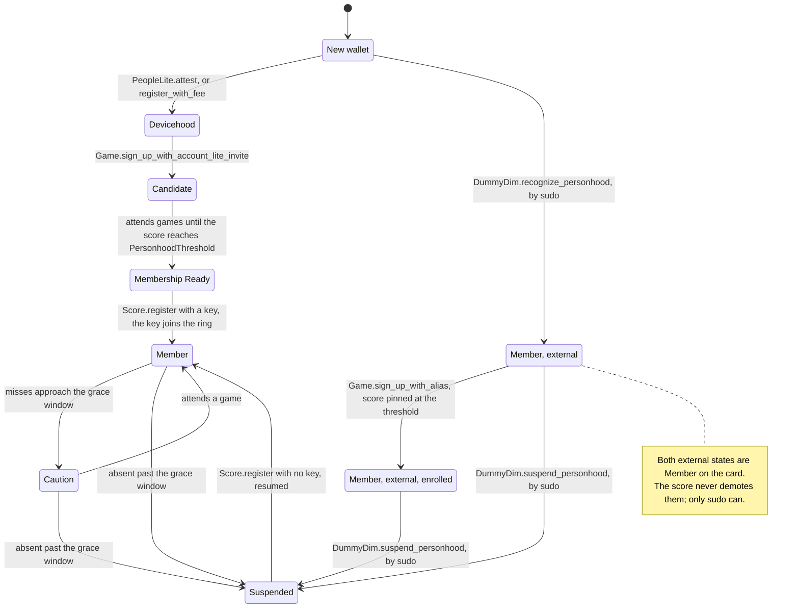
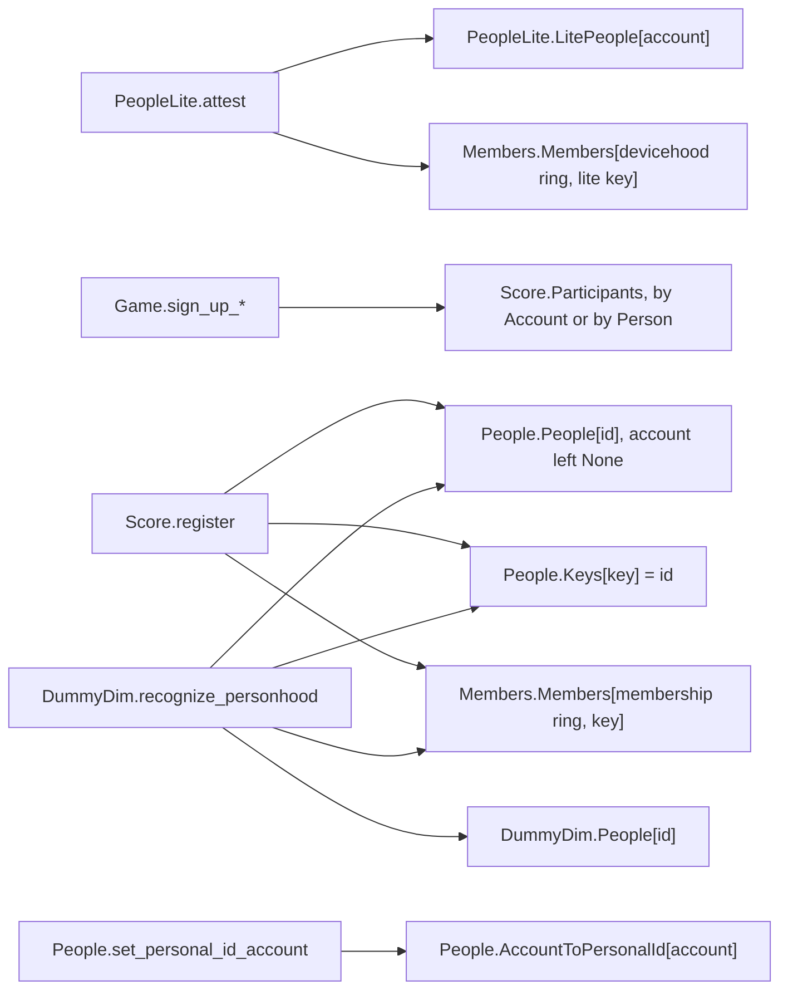
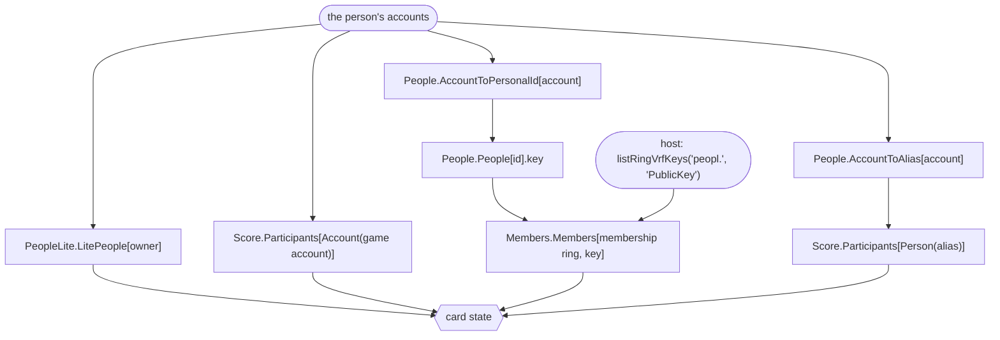

# States, and where they come from

[`CONTEXT.md`](./CONTEXT.md) names the states. This says how a person moves
between them, which runtime write causes each move, and which storage item this
app has to read to see it. It exists because the app is a *reader* of a state
machine it does not own: every state below is the runtime's, and the only thing
this app adds is the vocabulary.

The rule this follows: **model nothing the runtime does not already record.**
Where a distinction matters to the product, find the storage item the runtime
keeps it in. If there isn't one, that is a finding to take to the runtime, not
a thing to infer here.

## Two roads to Membership

There is more than one way into the Membership ring, and the runtime keeps them
apart by *which key the participant record is filed under*:

| Road | Score record key | `recognition` | Suspendable by the score? |
| :-- | :-- | :-- | :-- |
| DIM2 — play games, earn a score | `Account(game account)` | `NotRecognized` → `Recognized(id)` | **yes** |
| Another method — already a person | `Person(alias)` | `ExternallyRecognized` | no |
| Another method, never enrolled in DIM2 | *no record at all* | — | no |

That table is the whole answer to "is this Membership permanent or
conditional?", and it comes straight out of `indiv-pallet-score`:

```rust
// pallets/score/src/lib.rs — set_attendance
let mut suspend_personhood = !attended && score.reached_personhood &&
    match score.recognition {
        // Participants never lose personhood once they are externally
        // recognised or suspended
        ExternallyRecognized | Suspended(_) => false,
        Recognized(_)  => window == 0 || misses > allowed_misses,
        NotRecognized  => window == 0 || misses > allowed_misses
            || score.score < personhood_threshold,
    };
```

`ExternallyRecognized` people also have their score pinned to the threshold on
every attendance and never lose score on an absence. "Permanent" means *the
score will never demote them* — sudo still can, via
`DummyDim.suspend_personhood`, which removes the key from the ring like any
other suspension.

## The state machine



Both roads converge on the same write — `People.recognize_personhood(id,
Some(key))`, which calls `Members.add_members` on the Membership collection —
so both produce a key in the same ring, and neither is more of a Member than
the other. What differs is only what *else* got written on the way.

## What each move writes

`Members.Members[(ring, key)]` is the ring position: `Onboarding{queue_page,
queued_at}` when the key is queued, `Included{ring_index, ring_page,
ring_position}` once the offchain worker has rebuilt the ring, `Suspended` once
removed. Nothing else settles Membership.



Note what `register` and `recognize_personhood` both write: `PersonRecord {
key, account: None }`. **Neither road binds an account to the personal id.**
Only `People.set_personal_id_account`, called by the person themselves, does —
which is why `AccountToPersonalId` is empty for most people on previewnet and
cannot be the app's way into the ring.

## Which key stands in which ring

The two rings hold two different keys. Both derive from the personhood
product id **on this network** — `peopl.testnet` on previewnet, `peopl.paseo`
on paseo-next-v2 — with the index RFC-0022 fixes:

| Ring | Path | Index |
| :-- | :-- | :-- |
| Membership | `//peopl.<tld>//index_bytes(0)` | 0 — the full person key |
| Devicehood | `//peopl.<tld>//index_bytes(1)` | 1 — the light person key |

Per network, like proof contexts (`peopl.testnet`) and product accounts
(`dim2.testnet`) — **because that is what the phone does.** The iOS Polkadot
app reads the TLD from the DotNS protocol registry on chain and derives and
enrols people under it. Measured on paseo-next-v2 with one phone mnemonic:

| derivation | People ring | Devicehood ring |
| :-- | :-- | :-- |
| `peopl.paseo` idx 1 | | **`Included`** |
| `peopl.dot` idx 0 | `Included` — put there by a faucet that used `peopl.dot` | |
| `peopl.paseo` idx 0 | not there | |
| `peopl.dot` idx 1 | | not there |

RFC-0022 once spelled the paths as `//peopl.dot//…`, and older truapi hosts
pinned `peopl.dot` for their *wallet-internal* keys, which on every non-`.dot`
network was a different person from the phone's (the `peopl.dot` rows above).
Current hosts derive `peopl.<suffix>` from the network they are configured
for, the RFC reads `peopl.<tld>`, and the People runtime's `NetworkSuffix`
(`paseo`, `testnet`) is that suffix. The app never depended on it.

**Ring-VRF keys derive under the calling product's id.** So an app opened as
`peopl.<tld>` *owns* the person keys: `registerRingVrfKey(index, ring)` mints
exactly the bytes the iOS derivation produces (checked byte-for-byte against
truapi's own output for `peopl.testnet`), `listRingVrfKeys`
answers without consent, `ringVrfSign` accepts them. Getting the id wrong
produces a valid key that is in no ring, with no error to show for it.

## What Membership *is*, in the runtime's own words

One member key in the Membership ring. That is the whole definition, and the
runtime enforces exactly it — `pallets/people-multi/src/extension.rs`, the
`AsPerson` transaction extension:

```rust
Some(AsPersonInfo::AsPersonalAliasWithProof(proof, ring_index, revision, context)) => {
    ensure!(
        matches!(origin.as_system_ref(), Some(frame_system::RawOrigin::None)),
        InvalidTransaction::BadSigner
    );
    …
    let validated_ca = T::MemberService::verify_membership(
        PEOPLE_MEMBER_IDENTIFIER, proof, *ring_index, *revision, *context, &msg[..],
    ).map_err(|_| InvalidTransaction::BadProof)?;
    …
    origin.set_caller_from(Origin::PersonalAlias(validated_rev_ca));
}
```

`RawOrigin::None` — an **unsigned** transaction. No account, no signature, no
nonce, no binding of any kind. A ring-VRF proof verified against the ring root
*is* the proof of personhood, and the origin it produces is what
`Score::ensure_signed_or_person`, `Game::sign_up_with_alias` and every other
`EnsurePerson` check accept.

So: **hold the key, be in the ring, you are a Member.** Everything else is
plumbing downstream of that fact.

### The three account bindings, and why none of them is Membership

They are easy to confuse, they are all optional, and none is evidence of
anything the ring does not already settle:

| Binding | Storage | What it is for |
| :-- | :-- | :-- |
| `People.set_alias_account` | `AccountToAlias` | Lets a person transact as themselves *repeatedly* under one context, using the account's nonce for replay protection instead of a fresh proof. Bootstrapped by the proof-only path above, which is gated to exactly this call. |
| `People.set_personal_id_account` | `AccountToPersonalId` | Lets an account act as the `PersonalId`, again for the nonce. |
| `Score.register`'s participant account | `Score.Participants[Account(..)]` | DIM2's own bookkeeping. Not personhood. |

The first two exist because a ring-VRF key has no nonce and signing openly
with it would defeat the ring. They are spam protection, not identity. If this
app ever binds one it should be the personhood account, not the DIM2 candidate
account — and it must never *depend* on one being bound, because not binding
is a legitimate state a person can stay in forever.

## What the app reads, and what it misses



- **Gap A, closed: the ring read no longer depends on a binding nobody
  makes.** The host hands over the personhood ring-VRF public key and `Members.Members`
  is keyed by it, so the read is now one point lookup that needs no binding.
  `set_personal_id_account` exists so a person can *act* as themselves in an
  extrinsic — a ring-VRF key has no nonce, and signing openly with it would
  defeat the ring — and was never a membership index. The account walk stays
  as the fallback for runs with no host.
- **Gap B, closed: externally recognised people are visible.** The
  participant record of a person recognised outside this app is under
  `Person(alias)`, and the card now reads `People.AccountToAlias` for both the
  game account and the username owner and follows the bindings to
  `Score.Participants[Person(alias)]` whenever the `Account(game account)`
  record is empty. Only a binding whose `ca.context` equals
  `Score.score_context()` can be the person key, so a binding under any other
  context — Resources, airdrops — is skipped rather than looked up. Lite
  bindings are not read: `sign_up_with_lite_invite` also lands on an `Account`
  key, and `ensure_person` never accepts a lite alias.
- **Gap C — origin is not modelled, so the app can threaten someone the chain
  cannot demote.** Caution and Suspended are consequences of the score, and
  only the DIM2 road is score-administered.

## Open work

Reading the ring by key (`personhood-ring-key.ts`, `readRingStandingForKey`)
and reading `Score.Participants[Person(alias)]` through
`People.AccountToAlias` (`readAliasKeyedParticipant`) are done. Still open,
in order, because each step makes the next one cheap:

1. **Carry a `MembershipOrigin` on the snapshot**, derived from what is read
   rather than invented:
   - `"score"` — `recognition` is `Recognized(id)` or `NotRecognized`
   - `"external"` — `recognition` is `ExternallyRecognized`
   - `"unadministered"` — key in the ring, no participant record anywhere
2. **Gate Caution and Suspended on `origin === "score"`.** This is the
   correctness fix: only the DIM2 road is score-administered, so today a
   permanent Member with a stale attendance byte can render as at-risk, which
   the chain does not say.
3. **Upstream the ring read and the origin to
   `@parity/product-sdk-individuality`** once they have run against both roads
   on previewnet. They are chain reads with no product opinion in them, which
   is the bar for belonging there.

Nothing here depends on any account binding, by design.

`DummyDim.People[id]` would answer "did this person come from the faucet?"
directly, and is deliberately not used: it is one method's private mirror, and
DIM1 and DIM3 will each keep their own. "In the ring, with no score
recognition" generalises across all of them and reads the same for each.

## Settled: Humanity is the `peopl.<tld>` product

The phone is what people carry: on paseo-next-v2 a phone-onboarded person is
`peopl.paseo`, and a `peopl.dot` Membership made for the same mnemonic is a
person nobody's device is — see the table above.

**Therefore this app asks the host for the keys of `personhoodProductId(network)`
— `peopl.<tld>` — which is also the name it is opened as.** That is what
`personhood-ring-key.ts` does, and it is why the app can now register its own
key when the host holds none: only a deploy whose label is `peopl` does so
(`isPersonhoodProduct()`); a build that acts for `peopl` under another served
name reads and never mints. The citizenship
faucet derives under the same per-environment TLD (its `PRODUCT_TLD`, with
NEXTV2 → `paseo`), so faucet, phone and this app agree on every network.

The native iOS host (Swift TrUAPI, Rust-core switch off) has no RFC-0024 key
registry at all — `listRingVrfKeys`, `registerRingVrfKey` and `ringVrfSign`
answer `Unsupported`, and it picks the person key itself inside
`create_proof` / `get_alias`. There the card cannot read the ring by key and
falls back to the account walk, as before: Devicehood via
`PeopleLite.LitePeople[owner]`, Membership only through a
`set_personal_id_account` binding. That is the host's ceiling, not a fault.

Current truapi hosts derive their own reserved keys under `peopl.<tld>` too,
so a lite person the CLI creates is a `peopl.<tld>` Devicehood the key read
finds, and a phone-made person pairs with its username and reads its own
Membership. People made by an older CLI hold `peopl.dot` keys and have to be
onboarded again, and a Member recognised under `peopl.dot` is not a Member to
this app until re-recognised under `peopl.<tld>`.

The related question — whether `dim2` and the other ids carry a network
suffix — has the same answer: they do.
