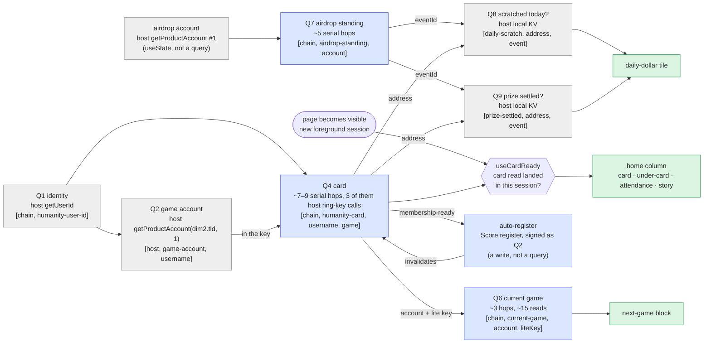
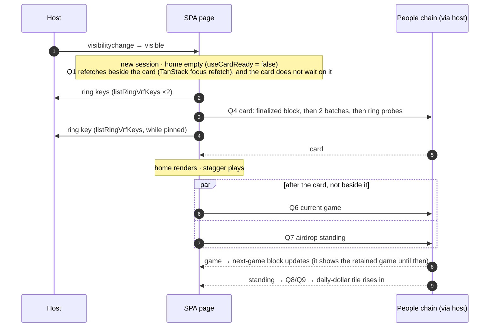
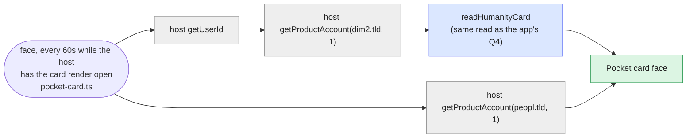

# Data flow

What the Humanity home and its worker read, what each read waits on, and what
the screen and the Pocket card show while they wait. Keep this in step with the
code: a PR that adds, re-keys or re-gates a read on the home or in the worker
updates this page.

Two runtimes read the same card. The **app** is the page the host opens under
the card. The **worker** is a headless script the host keeps warm: it draws the
Pocket card. They share no memory, only the
product's host storage (see [Shared storage](#shared-storage)). Both build the
card with the same code in `packages/humanity-shared` (`readHumanityCard`, then
`deriveHumanityCardState`), so neither has a state machine of its own: the
state is derived from the chain on every read, and `STATES.md` documents the
transitions the chain makes.

## The app

All of the app's reads go through TanStack Query (`apps/humanity-app/src/shared/chain/query-client.ts`).
Chain reads use one PAPI client per network that talks to the node through
the host bridge (`packages/humanity-shared/src/chain/connection.ts`). Host reads (accounts,
ring keys, local storage) go through the host SDK. Four query families
are persisted to localStorage for 30 days
(`apps/humanity-app/src/shared/chain/query-persistence.ts`): identity, card, current game and
airdrop standing.

### Dependencies

An arrow means "needs the answer of". Grey boxes are host calls,
blue boxes are chain reads, and green boxes are what the person sees.

### When each read runs

| | Query | Waits on | Fresh for | Refetch | Persisted | Blocks |
|---|---|---|---|---|---|---|
| Q1 | identity | — | `staleTime: 0` | on focus, on reconnect | yes | the card key |
| Q2 | game account | Q1 | `Infinity` | once per page load | no | the card key |
| Q4 | card | Q1, Q2 (key) | `0` | every 12s, on foreground (first) | yes | **the whole home** |
| Q6 | current game | Q4 data | `0` | every 30s, on foreground (after Q4) | yes | next-game block |
| Q7 | airdrop standing | airdrop account | 30s | every 12s, every best block, on foreground (after Q4) | yes | daily-dollar tile |
| Q8 | scratched today | Q4 address, Q7 event | 30s | — | no | daily-dollar tile |
| Q9 | prize settled | Q4 address, Q7 event | 30s | — | no | settled-win restore |

The card checks whether the finalized runtime supports `Resources.SigningContext`. The home offers a username upgrade only when this check succeeds. A direct claim link explains when upgrades are unavailable, and the submission checks again before binding or signing.

The 12s and 30s polls also run in the background
(`refetchIntervalInBackground`).

Q6 reads the game at the finalized block, plus the account's
`Game.Players` row at the best block: DIM2 confirms a sign-up at best, so a
registration there counts before finality catches up. An answer that would
offer Register ("not registered") is only shown once Q6 has been read in the
current foreground session (`offersRegister` in `use-airdrop-prize-page.ts`):
until then the next-game block waits, hidden, since the person may have
registered in DIM2 since and a held-over answer would flip to registered.
Register signs the game account up from here, on the flow DIM2 itself runs
(`@individuality/sign-up`, `features/card/chain/game-sign-up.ts`): the seat's
bind and the name link in the background, then the sign-up with its draw
entries. A host that cannot sign the game account up, or a name this product
cannot link (no PGAS on the game account), hands the sign-up to `dim2.<tld>`.

Q2 is the game's account, `dim2.<tld>` at index 1 by default
(`GAME_ACCOUNT_INDEX`, overridable with `VITE_GAME_ACCOUNT_INDEX`), the one the
game signs people up on and the score is kept against. It is asked again when
the host reports `Connected` after answering null. Once the card clears the
personhood threshold (`membership-ready`, or a candidate at the threshold),
`useAutoRegisterPersonhood` resolves the game account afresh and sends
`Score.register` signed as it. The host allows that only because `dim2`'s
manifest names `peopl` in `trustedProducts` with `context`; the grant in the
other direction, `peopl` naming `dim2` in Humanity's
`apps/humanity-app/deploy/bulletin-deploy.config.ts`, is what lets the game mint proofs with
`peopl`'s keys. The host caches a product's manifest for a day
(`MANIFEST_TTL_SECS` in truapi), so a new grant reaches an existing
install up to a day late. When the registration lands it invalidates the card, and the next read
shows `member`.

### Reopening the card

The host keeps the page alive between opens. Every return into view starts a
new foreground session (`apps/humanity-app/src/shared/session/foreground-session.ts`). Data from
before that session, whether in memory or restored from localStorage, does not
count. So the home stays empty until a card read from this session lands;
if that takes longer than 2.5s it shows the host's own card-opening spinner
(`LoadSpinner`), never a skeleton.

Only the home waits for this session's read. A screen the person left in the
middle of (the daily dollar, the promotion) stays up on the card it already had
while the read catches up underneath.

On a cold page load, Q2 also has to answer before the full card read can
start, because its address is part of the card's key. Until then the
card is read with a `pending-game-account` key, which is a short read that
can only say "account unavailable". A paired host relays Q2 to the phone and
can take most of its 30s timeout to answer.

### Where the time goes

What makes the wait longer, most expensive first:

1. **The card is one long serial read.** It reads the finalized block, then
   two dependent batches, then the ring-membership and devicehood probes,
   which include a `StaleRings` map iteration twice. It also makes three host
   `listRingVrfKeys` calls, one of them while the block is pinned. A pin lapse
   re-pins and restarts everything after the first two ring-key calls.
2. **The card key holds a host-resolved account.** On a cold load, the full
   read waits for `getProductAccount` (Q2), which is not persisted.
3. **The foreground refresh puts the card first.** On a return into view the
   handler refetches the game and standing only after the card lands
   (`apps/humanity-app/src/shared/navigation/humanity-action-session.tsx`). Their
   own polls and the standing's best-block refresh keep running meanwhile, and
   on a cold load the standing starts beside the card.
4. **The People client is never idle.** The standing invalidates on every
   best block, the card and standing poll every 12s, the game every 30s, and
   the stranded-prize sweep runs at boot. They all share the one client with
   the gating card read.
5. **Duplicated reads.** The game read runs the game state and `Game.Players`
   twice (`readCurrentGame` and `readLiteSignUpRequirement`). `visibilitychange`,
   `focus` and `pageshow` all fire the foreground handler, and a second one
   cancels the card read already in flight.
6. **Cold client.** Nothing pre-connects. The first chain read pays for the
   bridge handshake, the chainHead follow and the runtime metadata.

## The worker

The worker uses no TanStack Query: plain promises on one one-minute timer,
and nothing caches identity, the game account or the card between reads
(`apps/humanity-worker/src/`).

| Timer | Reads | Writes |
|---|---|---|
| face (60s while the render is open, and fresh when it opens) | identity (twice), airdrop account, game account, the card | the face to the host; `pocket:last-fill` when the stripe moves |

The timer reads the card once a minute while the render is open. The face is
the card through `pocketFaceOf`, the same
function the app uses, so the name is the card's (a claimed name included).
The app hands the worker the face of its own reads through `pocket:face-hint`,
so a change the app sees reaches the card within the worker's 2s poll; see
`apps/humanity-worker/POCKET.md`, "Keeping the face current".

### When the worker runs at all

The host decides, and the product cannot ask (truapi's worker-lifecycle and
Pocket-modality rules). A face changes only
while the host has the card's render open, which it does only while the card
is on screen; there is no background wake and none is planned. Between renders
the host shows the last face it stored.

| | Android | iOS |
|---|---|---|
| Worker runs | while a render is open (the card is on screen in the Pocket) | for the whole session while the card is held |
| App in the background, or Pocket tab left | render and worker stop about 5 s after; chain sockets close | worker kept but suspended with the app |
| Expanded card | shares the list card's render | opens a second render |
| App page after collapsing | kept alive, keeps running hidden | kept, detached, not paused |

Read from the host implementations; the host decides all of this and may
change it.

So a card off screen can be hours or days old when it comes back, and its first
fresh face waits for the worker to boot and read the chain.

## Shared storage

The product's host storage (`createLocalKvStore({ prefix: "humanity" })`) is
the only thing the app and the worker share. It has no change notification, so
a reader polls. Writes from the two runtimes to the same key are not
serialized against each other.

| Key | App | Worker |
|---|---|---|
| `daily-dollar:<airdrop address>` | reads; writes the scratched marker, registrations and its own reminder sweep | — |
| `pocket:last-fill` | — | reads and writes |
| `pocket:face-override` | writes (debug panel) | reads every 2s, debug builds only |
| `pocket:face-hint` | writes the face of each live card read that changes it | reads every 2s while the card's render is open; writes the face of each of its own reads |
| `daily-scratch:<address>` | reads and writes | — |
| `prize-winnings:<address>` | reads and writes | — |

Everything else the app keeps (the persisted query cache, the last card, hints,
pending claims) is in the page's `localStorage`, which the worker cannot rely on.
