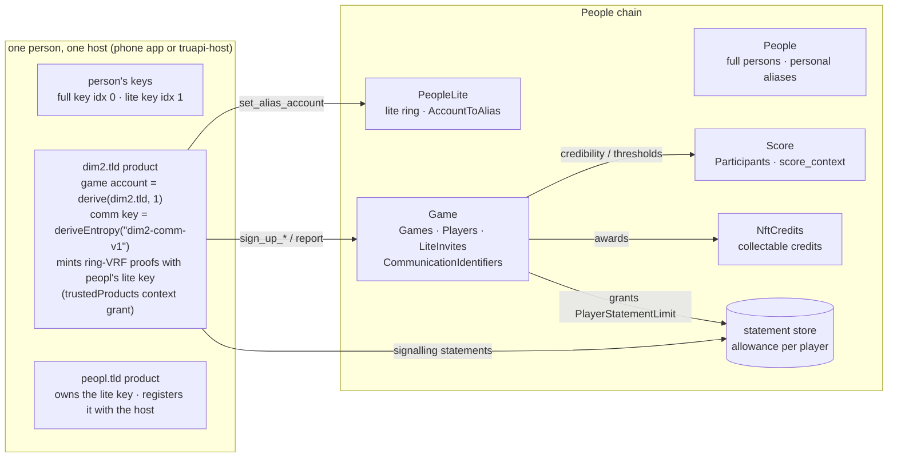
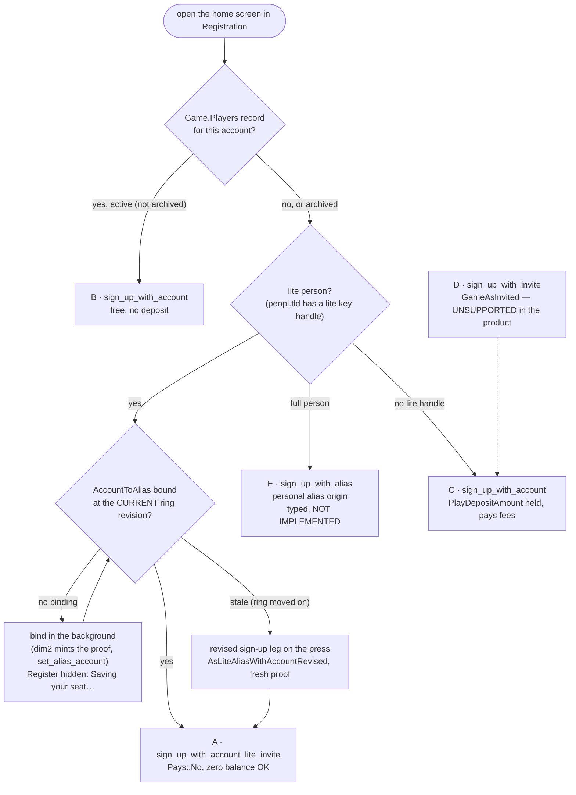
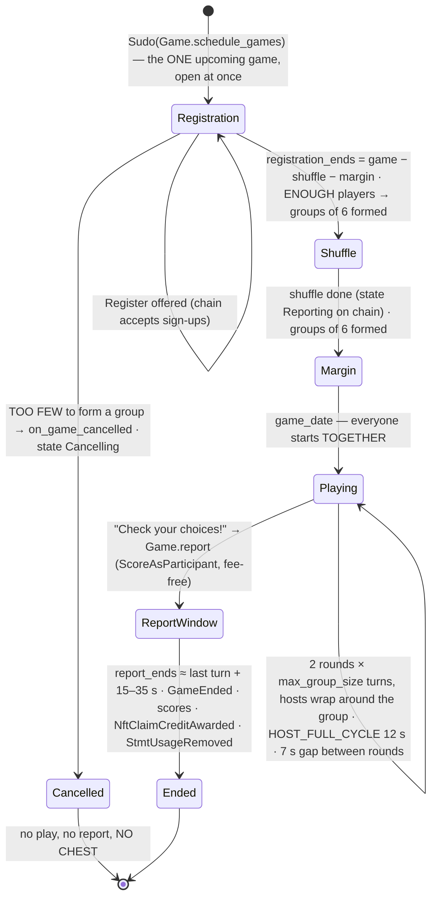

# CONTEXT — how a person gets to play Jollity, and what the chain does with it

The domain and application logic of the on-chain game in one place: the
actors, every route to a seat, the life of a game, and where each piece lives
in this repository. The root README says how to run things; AGENTS.md,
next to this file, says how the code is arranged; this file says what the
product *is* on chain. Keep it current when a route changes — it is the
document a reviewer reads first. Paths that start with `app/`, `components/`,
`lib/` or `public/` are in `apps/jollity-app`; every other path is from the
repository root.

On chain the game is the DotNS product **dim2** (`dim2.<tld>`, for example
`dim2.paseo` or `dim2.testnet`); "Jollity" is the name players see. Jollity
shares this repository with Humanity, the personhood product **peopl**
(`peopl.<tld>`). Both are products of the same *person*, hosted by the same
wallet app, and the free route below is a two-product handshake between them.

## How we talk to the chain — the dependency order (READ FIRST)

The product must be **fully buildable on `@parity/product-sdk` and truapi**.
Every new chain interaction — a read, a write, a signer, an origin, a proof —
goes looking there first, in this order:

1. **`@parity/product-sdk-*`** (host, individuality, tx, keys, …). The
   sources are at github.com/paritytech/product-sdk — read them when the
   published types aren't enough. If the SDK does it, we use the SDK, not our
   own version of it.
2. **truapi** — the host runtime (github.com/paritytech/truapi). Reach here
   for host capabilities the product-sdk layer doesn't expose (e.g.
   `truApi.signing.createTransaction` for an explicit envelope version).
3. **`polkadot-api` (papi) — ESCAPE HATCH ONLY.** It is the substrate the SDK
   itself rides (`fromPapi(client)`), not something app code should reach for.
   Use it directly only where product-sdk/truapi genuinely don't reach yet, and
   treat every such spot as debt to close. Building our own wrapper on papi is a
   rare, deliberate exception — justify it in the module header and open an
   issue upstream to fold it back into the SDK.

This is why the writes ride the individuality origin signers
(`withScoreParticipant` / `withLiteAlias`) and not hand-rolled papi
extensions; the reads the SDK does not offer yet are listed in §7.

## 1. Actors



- **A person** holds keys through their host. RFC-0022 numbers them: index 0
  is the full-person key, index 1 the lite key. The host derives one account
  per product from the person's entropy, so the game account of `dim2.tld` and
  the account of `peopl.tld` are unlinkable on chain.
- **The game product** (this repo) reads the chain, signs as the game account,
  and speaks the WebRTC signalling wire through the statement store. It never
  holds a personhood key; it MINTS personhood proofs with peopl's lite key
  because peopl's on-chain manifest grants it the `context` scope
  (`trustedProducts: { dim2: ["context"] }`, honoured by truapi 0.18 and
  later).
- **The personhood product** (`peopl.tld`, Humanity) owns the ring-VRF
  key, registers it with the host once at onboarding, and mints proofs in
  `Score.score_context`, the context every game credential is anchored to.
- **Pallets.** `Game` runs the game; `Score` keeps each participant's score,
  recognition and the personhood threshold; `PeopleLite` keeps the lite ring
  and the alias→account binding that makes the free route work; `People` keeps
  full persons; `NftCredits` holds the collectable credits a game awards; the
  **statement store** carries the signalling, gated by an on-chain allowance.

## 2. Identity on chain

| Thing | Where | Who writes it |
|---|---|---|
| Game account | derived by the host for `dim2.tld`, index 1 (the lite seats and scores on the current networks sit on it; `signupAccountIndex()` in `packages/jollity-protocol/src/config.ts`) | nobody — it is a derivation |
| Communication identifier (65 bytes; ours: uncompressed SEC1 P-256 key — see §5 for the phone's) | `Game.CommunicationIdentifiers[account]` | every sign-up rewrites it |
| Lite alias in the score context | `PeopleLite.AccountToAlias[account] = {alias, ring, revision}` | `PeopleLite.set_alias_account` (dim2, in the background, with a proof minted under peopl's grant) |
| The lite person's chosen playing account | `Game.LiteInvites[alias] = account` — pinned **forever** at the first free sign-up | `Game.sign_up_with_account_lite_invite` |
| Player record | `Game.Players[Account(account)]` — survives the game (`registered` flips back to false) | sign-ups, reports, archival |
| Score, recognition, last game | `Score.Participants[Account(account)]` | the report session |
| Statement allowance | on-chain allowance for the account, `PlayerStatementLimit` | granted at sign-up, removed at game end (`StmtUsageRemoved`) |

The comm key is derived, not stored: `deriveEntropy("dim2-comm-v1")` →
`commKeysFromEntropy` gives the P-256 scalar and the identifier the sign-up
publishes. A peer looks ours up in `CommunicationIdentifiers` and both sides
compute the same ECDH secret; that is the whole key exchange.

## 3. The routes to a seat

Five extrinsics can put an account into `Game.Players`. Which one applies is
decided by two things: *who the person is* (lite, full, nobody yet) and *whether
they already have a record*.



The SDK's seat (`@parity/product-sdk-individuality`) is the home screen's contract for this decision:
`SeatPath = "free" | "returning" | "deposit" | "unfunded"` — **free**
(A), **returning** (B), **deposit** (C, funds held) and **unfunded** (C without
the funds — the screen says how much is missing and shows the address); E is
not a path. `deriveSeat` is the one decision function; `Seat.ready` says
whether the path can be taken NOW (for the free path: the bind is in a best
block, and the name is linked, `packages/individuality-sign-up/src/seat.ts`).
The flow (`readSeat` → `register()`, run by `lib/game-source.ts`) reads it
with the SDK's `readGameSeat` from the blockers, the lite-key handle, the
balance, `Game.PlayDepositAmount` and the runtime's fee estimate, and re-reads
it when the balance or the binding moves.

**Policy.** The free lite route is the default and it is ONE
TAP: dim2 mints the proof and binds in the background, Register signs up.
- **A** is the product. Every lite person's first game (and every game after
  being archived) goes this way, for free, without leaving the app.
- **B** is free too and needs no proof: an active record signs up with
  `sign_up_with_account` under `ScoreAsParticipant`.
- **C** is the fallback for NON-PERSONS — an account with no lite key handle
  behind it (a host run for a product with no personhood, a script) — and is
  not preferred: it costs the deposit and the fee.
- **E** is typed (`person`) and documented below, not built. It is for a full
  person from the People ring who never played as an account; a player who
  becomes a person BY PLAYING keeps the account and stays on B (the pallet
  carries the credibility over in `sign_up_inner`).
- **D** is unsupported in the product: it needs Root to grant invites to an
  inviter and an off-chain exchange of the ticket, and there is no product
  flow for either.

### A · Lite person, first game (or after being archived) — the FREE route

Two transactions, both from dim2, one press. A fresh lite person needs no
balance: the bind lands in one block.

```mermaid
sequenceDiagram
  participant Host as host (phone app / truapi-host)
  participant Chain as People chain
  participant Dim2 as dim2.tld (game product)
  Note over Dim2: home screen reads: lite person (peopl.tld lite key handle), no binding, a game exists
  Dim2->>Host: createRingVRFProof(peopl's lite key, Score.score_context, message)<br/>allowed by peopl.tld's trustedProducts: { dim2: ["context"] }
  Host-->>Dim2: proof (ring, revision = current)
  Dim2->>Chain: PeopleLite.set_alias_account(gameAccount, valid_at_block)<br/>unsigned v5 general tx · AsLiteAliasWithProof · SDK-encoded, sent raw
  Chain-->>Chain: AccountToAlias[gameAccount] = {alias, ring, revision}
  Note over Dim2: "Saving your seat…" (no button) until the bind is in a best block → Register appears
  Note over Dim2: "Register" (one tap; open until registration_ends, game clock)
  alt binding at the current revision
    Dim2->>Chain: Game.sign_up_with_account_lite_invite(gameAccount, commKey, airdrops)<br/>signed by gameAccount · AsLiteAliasWithAccount(nonce)
  else stale binding (the ring moved on)
    Dim2->>Host: createRingVRFProof over the sign-up (fresh)
    Dim2->>Chain: the same sign-up under AsLiteAliasWithAccountRevised(proof)<br/>repairs the binding in the same call — no second bind
  end
  Chain-->>Chain: Players[gameAccount] (credibility Invited)<br/>LiteInvites[alias] = gameAccount (forever)<br/>CommunicationIdentifiers, statement allowance · Pays::No
```

- **Who mints.** The proof context is the personhood product's
  (`peopl.<tld>/Index(0)`, read from `Score.score_context`), and the key is
  peopl's lite key (RFC-0022 index 1). The host mints it for dim2 because
  peopl's on-chain dotNS manifest grants `trustedProducts: { dim2:
  ["context"] }` (truapi ≥ 0.18; the host logs "ring-VRF key access granted
  by the owner's manifest"). The doorway is `lib/host/sign-up.ts`, which
  hands the sign-up the SDK's `hostGameRegistrationCapabilities`, whose
  personhood prover lists `peopl.<tld>`'s ring-VRF keys, finds the lite
  handle by ring, and mints.
  NO lite handle means NOT a lite person (the SDK's `holdsLiteKey`), and the
  seat falls to C.
- **The bind is background work.** The moment the home screen reads a lite
  person with no binding and a game on chain, `lib/game-source.ts` submits
  the bind without a press and retries silently; the seat is `ready` once the
  bind is in a best block, and the button is replaced by "Preparing your
  seat…" until then. Nothing to confirm, nothing to pay. Each attempt has a
  deadline (`packages/individuality-sign-up/src/free-seat.ts`), and the SDK's
  `bindGameSeat` says what a refusal means: a
  transient one (a timeout, a proof the ring has not taken in yet, a dropped
  transaction) climbs a retry ladder; a permanent one closes the lite route
  for the session and the seat falls to C. The engine refuses BEFORE
  submitting when the person's free seat is on another account
  (`Game.LiteInvites` pins it forever, and `set_alias_account` would move the
  binding away from it), so a person who already plays free from one account
  is never bound to a second.
- **A stale binding is repaired on the press, not re-bound.** The binding
  stores the ring revision it was made under; the lite ring publishes a new
  root every few new lite people (every 20–35 minutes on a busy previewnet),
  and the chain then rejects the plain sign-up
  (`Invalid.Custom(172)`, `StaleAlias`). The revised leg —
  `AsLiteAliasWithAccountRevised` with a fresh proof over the sign-up
  itself, minted by dim2 at signing time — signs up AND re-points the
  binding in one call. **Once the sign-up has landed the revision no longer
  matters**: reports and later games run on the account (route B).
- **The draws ride the sign-up.** When the game schedules prize draws
  (`Game.Game.airdrops_scheduled`) and every draw is `Registering`, the
  sign-up carries one ticket per draw — an sr25519 VRF the host signs with
  the playing key (`accounts.signVrf`, `lib/host/sign-up.ts`), verified locally
  before it goes out; otherwise it carries none and the sign-up still lands
  (the SDK's `registerForGame`, with Jollity's draw rule on top in
  `packages/individuality-sign-up/src/chain/sign-up.ts`). A RECOGNIZED
  person's sign-up carries the `Alias` arm instead: one People-ring proof per
  draw with peopl's full key, in the draw's own context
  `product/<product_name>.<tld>/<event_id>` (People runtime 3004000), minted
  by the SDK's `registerForGame` with the sign-up's personhood keys
  (`lib/host/sign-up.ts`).
- **Index 1, one account per person, forever.** The sign-up and the bind use
  the product account at derivation index 1 (`signupAccountIndex()`).
  The pallet pins `Game.LiteInvites[alias]` to the first account that signs
  up free, forever: a person gets exactly one free-route account, so index 1
  is now pinned per person by the chain, and a person who loses that
  derivation cannot play free under another one.
- **Local testing.** After `npm run dev:host` onboards a fresh lite person,
  the truapi-host CLI (0.22 or later) lists peopl's lite key by itself.
  The app then binds and signs up by itself. One bind per person →
  a fresh slot (a local host session, `.truapi-host/<slot>`) per sign-up test.
- Code: the SDK's `readGameSeat`, `holdsLiteKey`, `bindGameSeat` and
  `registerForGame` (`@parity/product-sdk-individuality`: the unsigned v5
  bind envelope, the plain and the revised leg), behind
  `packages/individuality-sign-up/src/chain/sign-up.ts` (`signUpFlowChain`,
  which `GameEngine` carries), the flow in
  `packages/individuality-sign-up/src/sign-up-flow.ts` (the background bind),
  `lib/host/sign-up.ts` (the host's keys) and `lib/game-source.ts` (its wiring).

### B · Returning player — the account route, free

The pallet: "If the player is new or archived, then a deposit will be taken
from the signer. Otherwise the call is free." And for lite people: "Further
signups while the player is active must use `sign_up_with_account`." So a
lite person who played yesterday signs up today with a plain
`sign_up_with_account` — **no new bind, no ring revision involved.**

The home screen takes this branch as **returning** and signs up with
`signUpWithAccountTx` under `withScoreParticipant`, both from
`@parity/product-sdk-individuality`. The `ScoreAsParticipant` extension waives
the fee as it does for the report, so a zero-balance player needs nothing in
the account. "Returning" means an ACTIVE record. A player whose score fell to
zero is archived and starts over on routes A or C.
The same sign-up carries the prize-draw tickets when the game has draws, one
host-signed VRF per draw as on route A, or, once the player is RECOGNIZED,
one People-ring proof per draw (the `Alias` arm, as on route A). A host that
refuses the proof costs the draws, never the sign-up.

### C · Anyone with funds — the account route with a deposit

`Game.sign_up_with_account` from a funded account with no record: the pallet
holds `Game.PlayDepositAmount` (2 PAS on previewnet) and charges the fee,
refunded on success. **The fallback for anyone who is not usably a lite
person** — the doorway takes it when no lite key handle exists behind the
account, when the chain has closed the lite route for the account
(`LITE_CLOSED` in `packages/individuality-sign-up/src/seat.ts`), and when the background bind
was refused for good — the person's free seat is on another account, or a
refusal the chain would only repeat. The screen offers
Register only when the account holds the deposit plus two estimated fees;
below that it is **unfunded**: the copy names the missing amount and shows
the game account to top up, and the source watches the balance so a top-up
flips the screen within a block.
When the game has draws the sign-up carries the tickets too (one host-signed
VRF per draw, as on route A); the draws are skipped, never the sign-up, when
they cannot be entered — a wrong ticket count would fail the whole call and
cost the deposit.

### D · Invite ticket — `sign_up_with_invite` — UNSUPPORTED

A funded inviter posts a ticket (`Game.set_invite_ticket`), signs the
invitee's account id with the ticket key, and the invitee signs up with the
`GameAsInvited` extension: zero balance, no deposit, no fee. The route never
reached the home screen, and `packages/jollity-game-chain/src/chain/invite.ts`, which
built it for the local dev node, was removed once the lite sign-up superseded
it. Git history has it.

**Unsupported in the product, and why:** an inviter only has invites to hand
out after Root granted them (`Game.grant_invites`, sudo), and the ticket
signature has to travel from the inviter to the invitee outside the chain —
there is no product flow for either half.

### E · Full person — `sign_up_with_alias` — NOT IMPLEMENTED

A recognised person signs up under a *personal alias* origin: no deposit, no
invite, their score never falls below the personhood threshold and they are
never archived. The call names a `statement_account` for the game and carries
a signature proving the alias owns it (`proof_of_ownership_msg_base`). The
seat contract reserves the `person` path for it, and nothing takes that path.

Nothing outside this repository blocks it: the alias origin is a personhood
proof over the transaction itself, and `@parity/product-sdk-individuality`
0.6.0's `withAsPerson` builds it (proof, account and the revised form) the
way `withLiteAlias` builds route A's; the ownership `sig` needs a raw,
unwatermarked signature by the game account, which `@parity/product-sdk-host`
exposes as `signRawUnwatermarkedDeprecated` (deprecated upstream, a temporary
door). What is missing is on this side: the reads (a full person's record is
keyed by the ALIAS, not the account — `Game.Players[Alias]`,
`Score.Participants[Alias]` — and `readSeat`/`watchPlayer` read by account),
a full-person test subject (a People-ring member with NO account record — one
onboarded to full personhood outside the game, since a player who crosses the
threshold by playing stays on the account route B), and a non-deprecated
signer. It is not planned: nobody who reaches the game is a ring member
without an account record, and an archived lite player binds again and takes
route A.

## 4. The life of a game



**The timeline, from the Game pallet of the individuality runtime
(`pallets/game/src`, `GameTimes` + `game_date: game_play_time`). `game_date`
is the scheduled instant AND the synchronized play-start:**

| band | window (the phase lengths are per network; for example registration 300 · shuffle 120 · margin 30 s, or on previewnet 900 · 60 · 30 s; on both, `report_ends` falls about 15–35 s after the last turn) | on-chain state | what the player sees |
| --- | --- | --- | --- |
| registration | **from the `schedule_games` block** to `registration_ends = gd − shuffle − margin` (`gd−150` with the first example) | `Registration` | Register / You're in / funding gate |
| shuffle | `[gd−150, gd−30]` | `Shuffle`, then `Reporting` once done | **"registration closed — game starts in Xs"** (players being shuffled) |
| post-shuffle margin | `[gd−30, gd]` | `Reporting` | same get-ready countdown → hands over to /game |
| **play** | **starts at `gd`** | `Reporting` | the game (the dial, the tiles move in at T−2 → turns) |
| reporting | `[gd, report_ends]`, where `report_ends` is about 15–35 s after the last turn: play takes `rounds × max_group_size × HOST_FULL_CYCLE + (rounds − 1) × ROUND_GAP` (`packages/jollity-game-chain/src/game/constants.ts`), and the pallet's `report_ends` is what `lib/game-session.ts` times the confirm stage against (`AUTO_CONFIRM_SEC`). It also ends once every player has reported | `Reporting` → `PlayerProcess` → `GameEnded` | play + "Check your choices!" → /chest |

**Registration is open the moment the game exists** (the Game pallet's
`pallets/game/src/lib.rs`): `schedule_games` puts the game on chain
in `Registration` in the same block and `sign_up_inner` checks only that state
and `now < registration_ends`. The `registration` phase duration is the
pallet's SCHEDULING constraint — a game must be scheduled at least
registration + shuffle + margin ahead or `schedule_games` fails
`InvalidGameSetup` — not a gate on sign-up, and the app adds no band of its
own on top of it (`deriveStatus`, `lib/game-source.ts`). A game with players holds the slot
until its report window closes; a second schedule queues in `GameSchedules`
and is the one case where "scheduled, not open yet" is real. The whole flow
with its clocks is drawn in `docs/flow.md`.

The trap this table exists to prevent: the chain enters `Reporting` **as soon as
the shuffle completes** — often right after `gd−90`, up to a full minute before
`game_date`. `game_date` is NOT "when Reporting begins"; it is the moment every
client starts playing in lockstep. `post_shuffle_margin` is exactly this slack:
shuffle finishes early, everyone waits until `gd` to start together. So EVERY
countdown targets `game_date`, and the `[gd−90, gd]` gap is a real ~90 s that
needs its own "get ready" screen — left unrepresented it reads as "the app froze
right after the countdown ran out."

- Timing constants are the pallet's
  (`packages/jollity-game-chain/src/game/constants.ts`). The stage lengths of
  one turn (2 + 8 + 2 s) match the native Polkadot-app game clients (now
  discontinued, §5); the turn count does not. The native clients played one
  turn per player of the own group and stretched each turn to fill the round.
  The web plays one 12 s turn per SEAT of `max_group_size`, and a group
  smaller than that wraps its hosts around its own seats (turn t → seat
  `t mod n`, `hostSeat`: a group of 4 plays A B C D A B). A web player and a
  native player in one group would disagree on who hosts when; with the
  native clients gone, that mix cannot occur.
  The app measures every phase on `source.nowSeconds()`, the game clock: the
  device clock, corrected only by the peer check
  ([docs/time-and-clocks.md](../../docs/time-and-clocks.md)). Blocks do not
  move it, so a local dev node whose clock is wrong disagrees with the game
  clock.
- The chain holds one game at a time; a game with players holds the slot until
  its report window closes.
- **TOO FEW PLAYERS — a first-class state we must show, not a dead end.** When
  registration closes the pallet checks `GroupsSetting::acceptable_player_count`
  (the Game pallet's `pallets/game/src/types.rs`): if the sign-ups
  can't fill a group it runs `on_game_cancelled` and moves the game to
  `Cancelling` → cancelled — **no shuffle, no play, no report, no chest, no
  collectable.** On the default `max_group_size` 6 mainnet needs roughly
  `(g−1)(g−2)` players (a real handful); **on a testnet runtime the rule
  collapses to `player_count >= 1`** (the `T::TESTNET` branch), so a lone
  sign-up is NOT cancelled — it shuffles into a **group of one**. The grid
  draws one tile per held seat, so a group of one shows the player's own tile
  alone, and an empty chair still hosts its turns with no host (a larger
  group wraps its turns around its players instead). The player has nobody to
  connect to and no verdict to cast. A cancelled game reads as `processing`
  on the home (`wrapping-up`), the same as a game past its last turn. Either
  way the player registered, the countdown ran out, and there was no game for
  them; the screens do not yet say so in words (§7). Read the real player
  count from the game/shuffle state, not from your own optimism.
- **After the game** the `Players` record stays with `registered: false` and
  `first_game` set; `Score.Participants` carries `score`, `recognition`
  (`NotRecognized` until the threshold) and `last_attended_game`. Reaching the
  personhood threshold makes the player a recognised person (route E from then
  on). A player whose score reaches zero is **archived**
  (`Game.ArchivedPlayers`: "zero score but still onboarded") and is a new
  player again for the sign-up routes. A deposit player nobody voted human
  ends the game with score 0, streak `Absent`, the `Players` record gone, an
  `ArchivedPlayers` entry `Kickable`, **and the 2 PAS hold gone with it**
  (`System.Account.reserved` back to 0, `free` unchanged). The deposit is at
  stake, not parked. An archived account player idle past
  `NonPlayingKickoutTime` can be kicked out.
- Collectables: each report session awards `NftCredits` credits; `/chest`
  reads them back through `getClaims` from `@parity/product-sdk-nfts`.

## 5. Signalling and the mesh (JSON frames over the statement store)

Every two players in a group exchange their first WebRTC setup through the
People statement store, as JSON frames sent by `statementTransport`
(`packages/jollity-statement-core/src/statementTransport.ts`; its header is the spec).
The native Polkadot-app game clients for iOS and Android are discontinued,
and this app does not speak their SCALE `SignalingEnvelope` (offerId,
request/ACK session): there is no mobile-compatible pair wire. Where code
comments say "mobile parity", they mean a format kept byte-compatible with
those clients (the statement codec, the key derivation, the data-channel
frames).

1. **Addressing**: every label is `<namespace>|jollity:rtc-v5:<room>:<what>`
   (namespace = the product's DotNS host, room = `g<gameIndex>`: ONE room for
   the whole game), and a statement's topic or channel is the SHA-256 of that
   label. **One statement per phone** (`bundle: true`, rule 7 of the
   transport's header): every frame below that a phone wants live rides one
   bundle `{t: "b", from, sid, f: {p, "d:<peer>", "c:<peer>"}}` on its channel
   `bundle:<me>` under its own topic `from:<me>`, replaced (debounced) whenever
   any frame in it changes. A receiver reads the hello (`p`) and only the
   frames addressed to it, each through the same gates as before. The node
   keeps one statement per channel, so a newer bundle overwrites the older.
   A bundle that carries more than a hello goes deflated (`deflateBundles`:
   a `0x01` byte, then deflate-raw of the JSON; a hello alone stays plain).
   **Each phone listens to its roster alone** (rule 8, #1959): it subscribes to
   `from:<peer>` for every co-player of every round still to play, and drops a
   statement from anyone else. On one shared room topic every phone would
   receive every bundle of the game; in a 300-player load test the RPC lost
   95% of them that way.
   **The game's session**: a phone links during the pre-game countdown to every co-player of
   every round still to play. The round's group sends video both ways; a later
   round's co-players are linked on STANDBY, their video slot negotiated but
   empty until their round (`Mesh.setPeers`); a player with no round left is
   closed at the round change. A network change repairs each link in place
   (ICE restart, or a fresh connection that offers), never the room.
2. **Frames** (JSON, field `t`; every one carries `from` and `sid`):
   - **hello**: presence, `{name, view?}`, resent every 8 s as the
     heartbeat. A peer silent for 45 s is forgotten.
   - **bye**: sent on a clean close, alone in a final bundle.
   - **d**: one description per negotiation generation, `{name, gen, desc}`,
     re-announced on every heartbeat until the generation moves on. It already
     carries the candidates gathered before it went out.
   - **c**: the trickle stragglers, `{gen, cands[]}`, coalesced and debounced
     (700 ms) into the pair's single candidate slot, which each flush
     overwrites with the cumulative list.
   In the app `d` and `c` carry only a sealed blob (`s`): deflate, then
   AES-GCM under the pair key, the P-256 ECDH of the player's registered
   secret and the peer's identifier on chain (`Game.CommunicationIdentifiers`),
   through HKDF with the label scheme `jollity:rtc-v5` as its info, and with
   the header `t|from|to|gen|sid|z` (`z` the compression flag, 0 when absent)
   as additional data. An unchanged re-announce re-sends the same blob. Nothing directed
   goes or is taken in the clear; a peer with no identifier gets no frames.
   Presence stays in the clear. There is no ACK: loss is healed by the heartbeat
   re-announce, and submits are capped in flight, one per channel.
3. **Generation (`gen`)**: an offer mints `<sid>.<n>`; the answer and the
   candidates carry the gen of the offer they answer (the mesh echoes it, so a
   slow answer to an old offer cannot be taken for the new one), and a
   receiver drops any answer or candidate whose gen is not the current one for
   that peer.
4. **Session id (`sid`)**: `<session-clock ms>-<random tag>`, minted once per
   page boot (the game clock in the app, so boots order across phones,
   falling back to the device clock before the game source registers it),
   shared by every room of that boot. A reload
   leaves its old frames in the store for up to a TTL, so the receiver keeps
   each peer's current sid and takes d, c and bye from that sid alone. **Only
   a hello switches sessions** (the presence slot is one per account, so a
   stale hello cannot outlive the live one; a d or c slot is per pair and
   survives its boot, so a re-read one proves nothing). While the current sid
   is live (a hello within 20 s, no bye) another sid's hello switches only if
   it sorts newer and was not left before. The order is a hint, not a lock:
   once the current sid has said bye or been silent for 20 s, any sid's hello
   takes over, so a wrong phone clock delays a reload by at most 20 s and never
   locks it out. A new sid resets that peer's negotiation state and raises
   `onPeerSession`, which makes the mesh rebuild the link. Within a sid an offer
   whose counter is below the last adopted one is dropped. A frame without a
   sid is taken as before, with no ordering and no session event. A new boot's
   desc that lands before its first hello is dropped and waits for the next
   heartbeat (8 s at most).
5. **Statements are proved as the PLAYER** (`lib/host/statement-store.ts`,
   `truApi.statementStore.createProof({ productAccountId })`): the Game pallet
   granted this account its allowance at sign-up, and removes the usage when
   the game ends (`StmtUsageRemoved` — outside an active sign-up every submit
   is `noAllowance`). The product's own RFC-0010 allowance is not involved,
   and the SDK's `getStatementStore().createProofAuthorized` signs with THAT
   account, so never pass the SDK store straight into the transport: the
   node refuses its proof, the truapi-host CLI cannot even sign it
   (`UnableToSign`), and the mesh stays dark. The per-account call is
   deprecated upstream on purpose.
6. **Media and every renegotiation** ride the data channel's renegotiation
   lane (`webrtc_renegotiation_internal_use_case`, a SCALE mux frame from
   `dataChannel.ts`); gestures ride `video_game_gesture_acceptance`. Only the first negotiation touches the
   statement store.

The statement codec (`statement.ts`) and the data-channel frames are pinned
by unit tests against vectors from the native clients.

**Host quirks.** The debug export (tags `source`, `engine`, `host`,
`statement`, `rtc`, `wake`) is how each of these shows up on a phone.
[docs/known-issues.md](../../docs/known-issues.md) lists what the app works
around and where.

- **Wire codec.** The host and the SDK do not negotiate a codec: it moves
  with the truapi version (0.13 = 1, 0.16 = 2, 0.20 = 3), and skew shows
  up as `getProductAccount failed: Malformed protocol error payload`, which
  looks like "not in a host". A local `truapi-host` must match the one
  `@parity/truapi` in package-lock.json, and `npm run dev:host` warns on a
  skew: app, CLI and phone move together. truapi-host 0.23.0 and later build
  the stock signer's transaction completely, which the app relies on.
- **Detection.** The host has no chain discovery; `lib/engine.ts` falls back
  to a genesis keyed by the product TLD. Both host paths on iOS set the
  bridge marks synchronously at document start, so detection itself is not
  racy.
- **Index 1.** The player is the product account at derivation index 1. The
  native game that claimed index 0 is gone, but every lite person on the
  current networks is pinned to their index-1 account (`Game.LiteInvites`)
  and every score sits on it, so moving would cost them both. Humanity reads
  the same index (`signupAccountIndex()`), so the two products change it
  together; `NEXT_PUBLIC_SIGNUP_ACCOUNT_INDEX` overrides it.
- **Standby.** A phone asleep on the waiting room loses the host's chain
  connection and its bridge port (`message port closed unexpectedly`); truapi
  forgets the port and the host never re-injects one, so every later host
  call hangs. Ours are stopgaps — a screen wake lock while a game is pending
  or running (`lib/wake-lock.ts`) and a capped reload when the SDK reports the
  channel disconnected (`watchHostChannel`) — the reconnect is the host's.
- **The native TrUAPI runtime drops statement subscriptions.** Some iOS host
  builds run products on the native runtime (host-rust-core). Its chain
  RPC is bridged through an adapter with a closed table of subscription
  families, and `statement_subscribeStatement` is not in it: the node's
  subscription id comes back like a call result, the core believes it is
  subscribed, and every `newStatements` notification is dropped. Submits and
  chain reads work, so sign-up and reports succeed while the phone never
  receives one statement (raw-RPC probes show the node delivering to every
  other connection). Nothing here can work around it; until the iOS host
  forwards that family, test on a phone with the native runtime OFF (debug
  settings → JS container). The JS container's `createStatementProof` has its
  own quirk: it signs with the wallet's main derivation for the TLD
  regardless of the requested account.
- **TURN.** Credentials come from the identity backend's
  `/api/v1/turn/issue-with-proof`, which answers CORS and takes a personhood
  proof (`deviceUniquenessBackendUrl` in `packages/jollity-protocol/src/config.ts`).
  The host's `fetch` wrapper ignores abort signals, so the fetch races a hard
  deadline.

## 6. Local development setup (what stands in for what)

| Production | Locally |
|---|---|
| Wallet app hosting both products | the `truapi-host` CLI at the lockfile's `@parity/truapi` version: `npm run dev:host` runs dim2 |
| peopl app registering the person's lite key with the host (once, at onboarding) | nothing: the CLI (0.22 or later) lists peopl's lite key by itself |
| The bind and the sign-up | the app itself (`lib/game-source.ts`), same as on a phone |
| Scheduled games | `Sudo.sudo(Game.schedule_games)` from a sudo key for your network; `max_group_size 2` for a two-player test. `Sudo.Sudid` tells the truth (`ok` is the outer call) |
| Two phones | two host sessions (`HOST_SESSION=bob`, or `HOST_CLI_SIGNER_MNEMONIC` for an existing identity; pin `HOST_PORT`/`APP_PORT`), or two browser tabs |
| A phone | the Polkadot iOS app on the same wifi, native runtime OFF; both debug exports read side by side |
| Is the node delivering statements? | a raw `statement_subscribeStatement` on separate connections while a host session submits as the signed-up player (it needs an active sign-up for the allowance) |

## 7. Known gaps

- **Host issues not yet reported upstream.** The truapi bridge transport
  closes for good after a port error; on iOS the bridge and the chain
  connection die on standby; and the iOS native runtime delivers no
  statement-store subscription updates (§5, host quirks).
- **Full persons** (route E) are typed but not built, and not planned (§3).
- **Reads the SDK does not offer yet** stay in `@jollity/game-chain` (for
  example the draws' winning tickets, `fetchAirdropDraw`); per the dependency
  order at the top, they move onto the SDK when it gains them.
- **Too few players has no screen of its own.** A cancelled game reads as
  "wrapping up" on the home, and a group of one plays its turns with nobody
  to connect to (see "TOO FEW PLAYERS" in §4). The on-chain minimum is not
  enforced on a testnet runtime (the `T::TESTNET` branch), so under-minimum
  games happen there routinely. A "not enough players — no game this round"
  path should drive off the real player count and the `Cancelling` state,
  never off local optimism.
