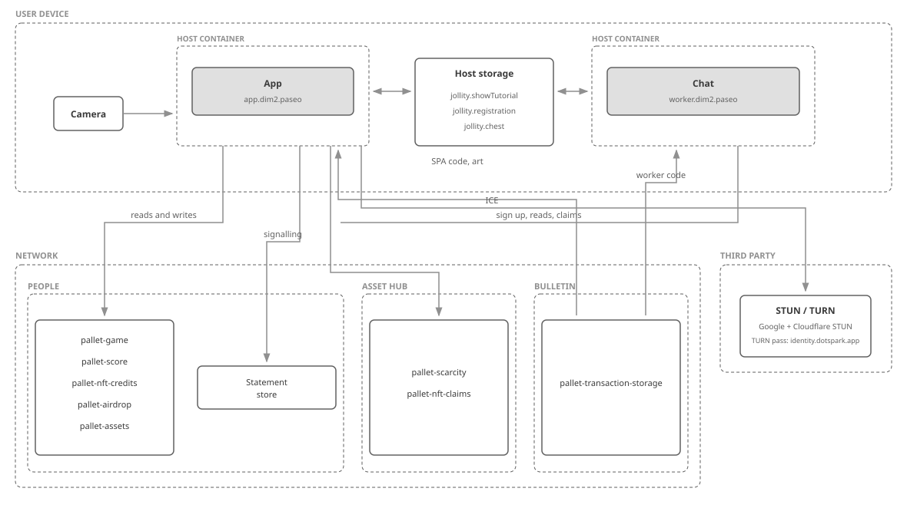
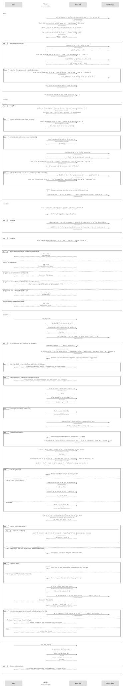
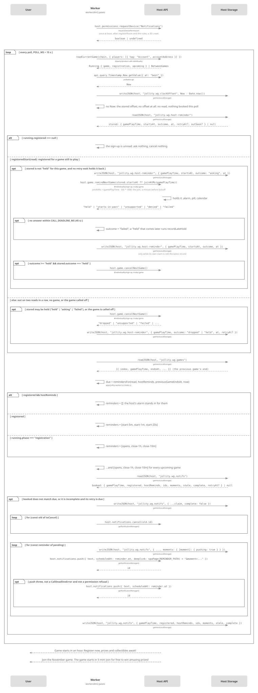
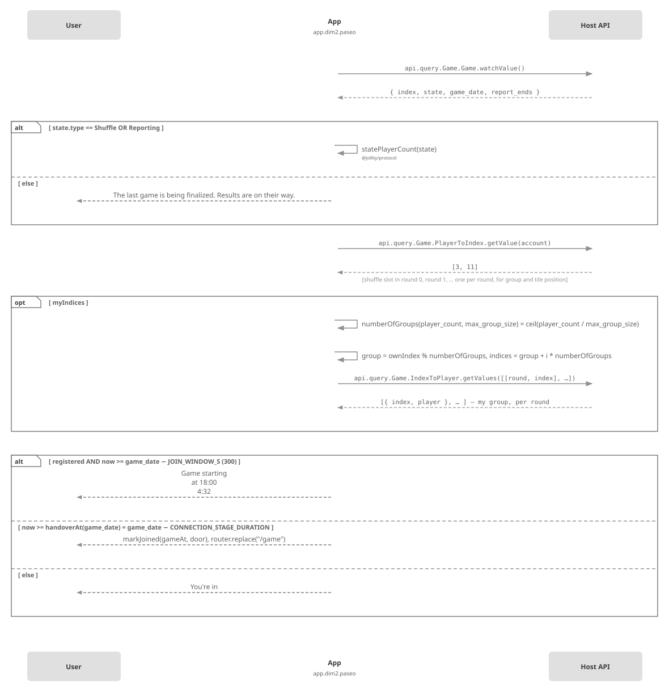
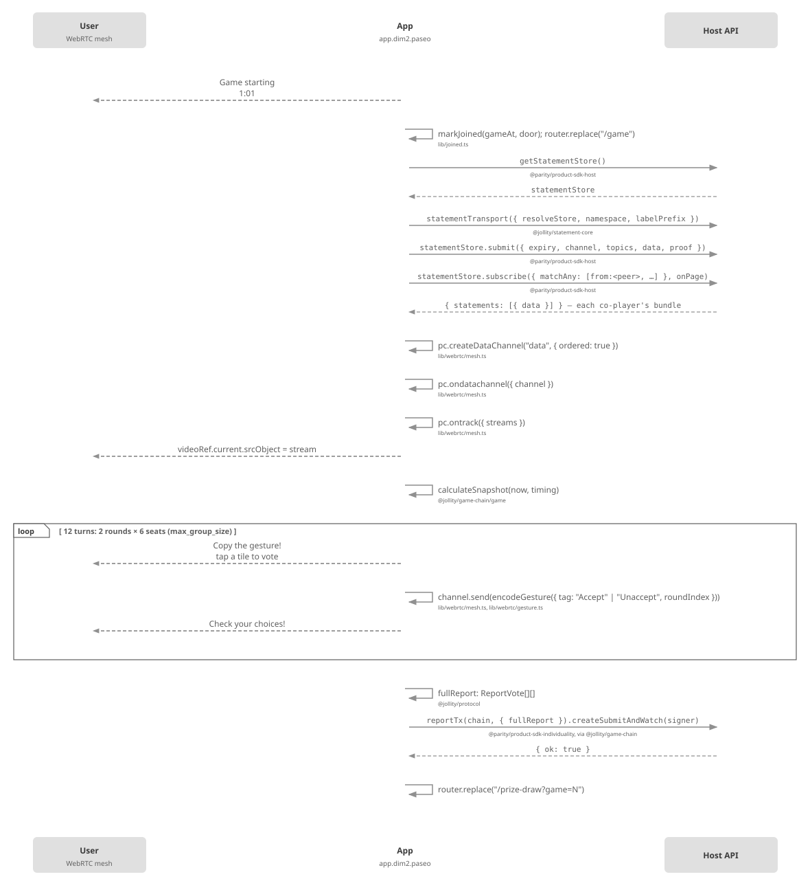
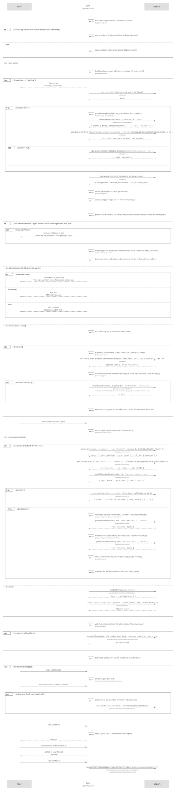

# Architecture

Jollity is two executables that a Polkadot host runs side by side: the app
(`apps/jollity-app`, a Next.js static export) and the chat worker
(`apps/jollity-worker`, a bundle the host runs in its own worker context).
Neither has a server of its own. They read and write the People chain and
Asset Hub through the host, signal each other's phones over the People
chain's statement store, and share a few records in host storage. The
diagrams below follow one game through them, in the order a player meets it.

Each caption says whether the diagram shows the code as it is. Three diagrams
are generated from a Python source next to the SVG; the other four are
hand-drawn SVGs with no source. [`assets/README.md`](assets/README.md) says how
to regenerate the generated ones. [`flow.md`](flow.md) has the same game as
one timeline and one sequence, chain to screen, and
[`time-and-clocks.md`](time-and-clocks.md) has the clocks every countdown here
reads.

## The parts

The boxes and arrows between the device, the host, the chains and the TURN
service. **Current, with two arrows missing:** the chat worker also reads the
collectables on Asset Hub (`apps/jollity-worker/src/chain.ts`), and the app's arrow
to Asset Hub carries the collectables it reads and the DotNS name link it
writes (`packages/jollity-collectables`, `packages/individuality-name-link`).
Host storage shows three of the keys the app and the worker share; the full
list is in `apps/jollity-app/lib/worker-bridge.ts`, and the records one
product keeps for the other are in `packages/shared-records`. TURN relays are
handed out by the network's identity backend in exchange for a personhood
proof (`apps/jollity-app/lib/webrtc/ice.ts`). Hand-drawn.

## Registration

The app's own sign-up from the home screen runs the same engine as the chat's below:
`apps/jollity-app/app/page.tsx`, `lib/game-source.ts`, `lib/host/sign-up.ts` and
`packages/individuality-sign-up/src/sign-up-flow.ts`.

### From the chat

The worker's boot, its 15 s poll, the game card it keeps up to date and a sign-up
from the card's Register button, to the card's outcome and "Start playing".
**Current.** The code: `apps/jollity-worker/src/index.ts` (boot, poll, card,
the reminder gate), `src/signup.ts`, `src/card/` and `src/host.ts`. Generated
from `assets/journey-register-chat.py`.

## Notifications

How the worker keeps the host's one game reminder on the game the player is
registered for, and books its own notices for the next game on every poll.
**Current.** The code: `apps/jollity-worker/src/index.ts` (`keepReminder`,
`cancelHostReminder`, `remindersFor`, `bookReminders`), with the record both
surfaces share in `packages/individuality-sign-up/src/reminder.ts` and
`packages/jollity-protocol/src/host-reminder.ts`. Generated from
`assets/journey-notifications.py`.

## Shuffle and the waiting room

How the app reads its group once the chain has shuffled, and when it hands the
player from the waiting room to `/game` (`handoverAt`, 64 s before kickoff).
**Current in its calls, not in its order:** the group reads are drawn before
the waiting room, but the app makes them on `/game`, after the handover
(`lib/game-session.ts`, `lib/game-source.ts` over the SDK's
`readPlayerIndices` and `readGroupMembers`). The waiting room is
`components/waiting-room/` and the handover `lib/joined.ts`. Hand-drawn.

## The game and the report

From the handover through signalling over the statement store, the data
channel and video, the turns and the votes, to the report. **Current in
outline:** it leaves out the statement proof the app makes as the player
before each submit (`truApi.statementStore.createProof`, in
`lib/host/statement-store.ts`) and the sealing of each phone's bundle
(`packages/jollity-statement-core/src/statementTransport.ts`). The mesh is
`lib/webrtc/mesh.ts`, the turns `packages/jollity-game-chain/src/game/`, and
the report `packages/jollity-game-chain/src/engine.ts`. Hand-drawn.

## The payoff

From the report through the prize draw, the claim of a won prize and the
collectables screen, to the hand-off to the player's Humanity card in Pocket. **Current.**
The code: `lib/draw/` (the draw screen's reducer, its load and the claim),
`lib/collectables/` and `packages/jollity-collectables` (the collectables screen and its read), and
`lib/membership/humanity-target.ts` (the hand-off). Generated from
`assets/journey-player-process.py`.

App paths above without a folder are under `apps/jollity-app/`.
