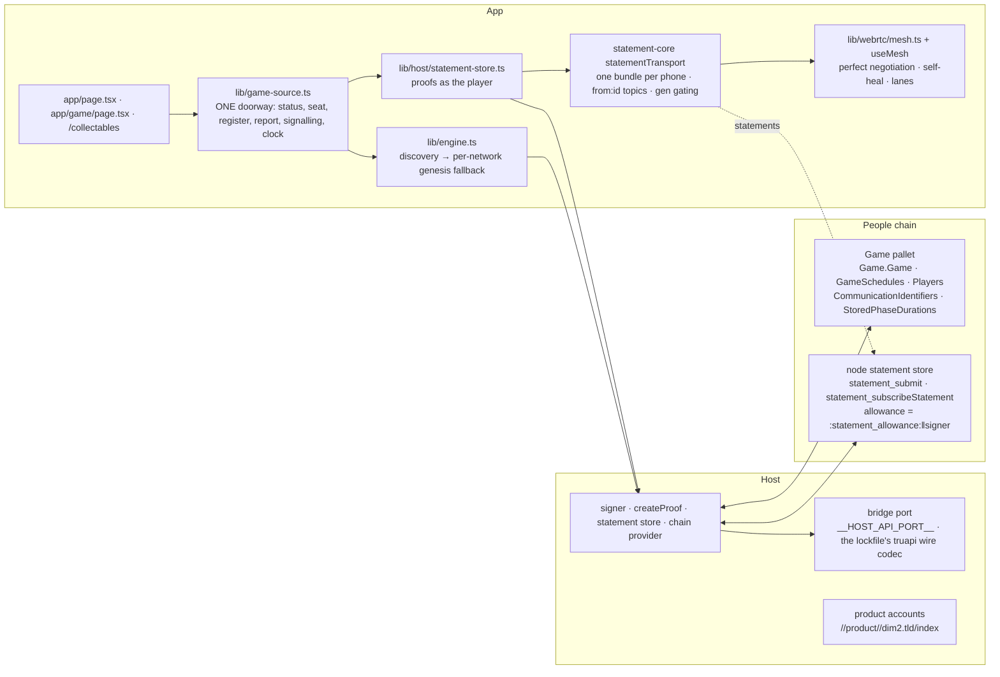

# The whole flow — chain, host, app

One game of Jollity, from a sudo call to a collectables screen, with what happens ON CHAIN
(the Game pallet on the People chain), IN THE HOST (the Polkadot app or the
local `truapi-host` CLI), and ON SCREEN (the app). The chain's timings are the
pallet's stored phase durations, which each network sets; the numbers below
are an example (registration 300 s, shuffle 120 s, post-shuffle margin 30 s),
and on both test networks `report_ends` falls about 15–35 s after the last
turn (CONTEXT.md §4). The app's timings are its own constants
(`packages/jollity-game-chain/src/game/constants.ts`). `gd` = `game_date`, the
synchronized play start. This page describes the code as it is.

Read together with [`apps/jollity-app/CONTEXT.md`](../apps/jollity-app/CONTEXT.md)
§4 (the life of a game) and §5 (signalling and the mesh).

## 1. Timeline

```mermaid
gantt
  title One game with the example durations (chain clock; gd = game_date)
  dateFormat HH:mm:ss
  axisFormat %M:%S
  section Chain
  schedule_games → NewGame, state Registration : milestone, m1, 00:00:00, 0s
  Registration open (sign_up* accepted) : a1, 00:00:00, 450s
  registration_ends = gd − 150 → Shuffle (or Cancelling) : milestone, m2, 00:07:30, 0s
  Shuffle (groups of max_group_size) : a2, 00:07:30, 120s
  state Reporting (post-shuffle margin, nothing to do) : a3, 00:09:30, 30s
  gd — play starts in lockstep : milestone, m3, 00:10:00, 0s
  Reporting window (Game.report accepted) : a4, 00:10:00, 181s
  all reported or report_ends → PlayerProcess → GameEnded : milestone, m4, 00:13:01, 0s
  section App
  REGISTER offered as soon as the game exists : b1, 00:00:00, 450s
  "You're in" countdown : b2, 00:00:00, 300s
  Waiting room (T−300 … T−64) : b3, 00:05:00, 236s
  handover to /game at T−64, dial to 00 at T−3, 00 until T−2 : b4, 00:08:56, 62s
  tiles move in T−2 … T−0, mesh already forming : b5, 00:09:58, 2s
  Round 1 (6 turns × 12 s) : b6, 00:10:00, 72s
  round gap 7 s, Round 2 : b7, 00:11:12, 79s
  "Check your choices!" (7 s confirm) → report : b8, 00:12:31, 15s
  /prize-draw (when the game has draws) : b9, 00:12:46, 60s
  /collectables : b10, 00:13:46, 60s
  section Mesh
  each phone's bundle (hello + offers) re-sent by heartbeat : c1, 00:08:56, 215s
  offer/answer over the statement store : c2, 00:08:56, 64s
  data channel + video (renegotiation lane) : c3, 00:10:00, 151s
```



## 2. The sequence

```mermaid
sequenceDiagram
  autonumber
  participant S as Sudo (scheduler)
  participant C as People chain · Game pallet
  participant H as Host (Polkadot app / truapi-host)
  participant A as App (this repo)
  participant P as Peer's app

  S->>C: Sudo.sudo(Game.schedule_games{game_play_time, rounds, max_group_size})
  C-->>C: Game = Registration{next_player_index 0}, registration_ends = gd − shuffle − margin
  C-->>A: NewGame event / Game.Game read (via the host provider; paseo's genesis as the fallback when discovery answers nothing)

  Note over A: home: status "registration" the moment the game exists → REGISTER

  A->>H: getProductAccount(dim2.tld, signupAccountIndex)  ⟵ 1 on paseo and previewnet: the lite seats and scores there sit on it
  H-->>A: ProductAccount{publicKey, derivationIndex 1}
  A->>H: listRingVrfKeys(peopl.tld) → the lite key handle  ⟵ none = not a lite person → deposit route
  A->>A: seat path (the SDK's readGameSeat, packages/individuality-sign-up): free / returning / deposit / unfunded
  Note over A,H: free path, no binding yet: BACKGROUND BIND, no press
  A->>H: createRingVRFProof(peopl's lite key, Score.score_context)  ⟵ peopl's trustedProducts grant
  A->>C: PeopleLite.set_alias_account (v5 general transaction, AsLiteAliasWithProof, SDK-encoded) — retried silently
  C-->>A: AccountToAlias[account] in a best block → seat ready (an I'll be there tap before then shows nothing until the seat links)
  A->>H: createTransaction + sign (host picks v4/v5, fills VerifyMultiSignature)
  A->>H: signVrf(player account, pop:airdrop transcript) × airdrops_scheduled  ⟵ only when every draw is Registering; a draw not open yet is waited for, then the sign-up goes without a ticket
  H-->>A: VRF pre-output + proof per draw (verified locally against the playing key)
  Note over A,H: a recognized person instead: createRingVRFProof(peopl's full key, product/<product_name>.<tld>/<event_id>, 0x01 ++ account) × airdrops_scheduled — the Alias arm
  H->>C: Game.sign_up_with_account_lite_invite (AsLiteAliasWithAccount; stale binding → …Revised with a fresh proof, one call; airdrops = the tickets) — accepted while state Registration && now < registration_ends
  Note over A,C: returning: sign_up_with_account under ScoreAsParticipant · non-person: sign_up_with_account + deposit — both carry the same tickets
  C-->>C: Players[who], statement allowance for `who` (PlayerStatementLimit)
  C-->>A: SignedUp{who} → "You're in" (optimistic on broadcast, confirmed by watchPlayer)

  Note over C: registration_ends: acceptable_player_count? → Shuffle : Cancelling (no collectables screen)
  C-->>C: Shuffle steps → groups · state Reporting (may finish up to a minute before gd)
  C-->>A: Game.Game{state Reporting, group members} + Game.CommunicationIdentifiers

  Note over A: T−300 waiting room · T−64 handover to /game (dial), mesh opens · T−3 dial at 00 · T−2 tiles move in

  A->>H: getStatementStore().subscribe(matchAny[from:<peer> for each co-player])  ⟵ the roster wire: no room topic
  A->>H: truApi.statementStore.createProof({productAccountId: sign-up index, statement})  ⟵ proved AS THE PLAYER
  H-->>A: Sr25519 proof by the sign-up account (the only key with allowance)
  A->>H: store.submit(my bundle under from:<me>: hello + a sealed desc/cands per peer) — re-sent by heartbeat
  H->>C: statement_submit → node statement store (allowance checked: noAllowance otherwise)
  C-->>P: statement_subscribeStatement page → my bundle (hello)
  P->>C: its own bundle, now carrying an offer for me (data channel only, candidates inside)
  C-->>A: page → offer → my answer goes back in my bundle
  A-->>P: ICE (STUN, TURN from the identity backend when reachable) → DTLS → data channel
  A-->>P: media + every renegotiation over the channel's lane · gestures over the gesture lane

  Note over A,P: gd: round 1, 12 s turns · round change · round 2 · "Check your choices!"
  Note over A: confirm roster = the union of every round's group, you excluded · one verdict per player, repeated in every round entry of the report

  A->>H: sign Game.report(votes)  (createAndSubmit)
  H->>C: ReportSubmitted{who, game_index}
  C-->>C: all reported or report_ends → PlayerProcess → scores, NftClaimCreditAwarded, StmtUsageRemoved, GameEnded
  Note over A: /prize-draw?game=N reads the draws (or /collectables when none was scheduled)
  C-->>A: /collectables reads awarded credits (getClaims)
```

## 3. Where each thing lives



## 4. The clocks

- Every countdown uses `source.nowSeconds()`: the device clock plus an
  offset. The peer check over the mesh is the only thing that moves the
  offset. The chain check only measures the gap between the device clock and
  block time, for the TURN proof stamp, and never moves the clock
  ([time-and-clocks.md](time-and-clocks.md)).
- The pallet gates on block time. `game_date` is the play start for everyone;
  `registration_ends` is `gd − shuffle − margin`, NOT `gd − registration −
  shuffle − margin`: the `registration` duration is the scheduling constraint
  (how far out a game must be scheduled), not a gate on sign-up.
- A round plays `max_group_size` turns of `HOST_FULL_CYCLE`, whatever the
  sign-up count. A seat that no player holds shows static and hosts nothing:
  the turns wrap around the seats players hold (turn t → seat `t mod n`,
  `hostSeat`), so a group of 4 plays A B C D A B. Only a group of one leaves
  its empty seats' turns with no host. A 7 s `ROUND_GAP` sits between two
  rounds (151 s of play with 6 seats).
